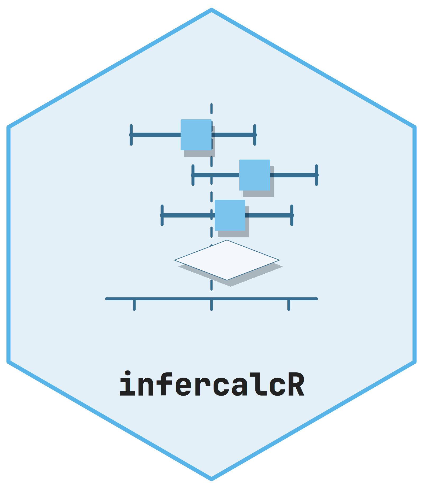

# infercalcR <picture class="cttir-readme-logo"><source class="cttir-logo-dark-source" media="(prefers-color-scheme: dark)" srcset="man/figures/logo-dark.png" /></picture>

Explicit observed statistical procedures, diagnostic calculations and finalized
results in R. `infercalcR` supplies the computational core of the inference suite;
`inferguidR` provides guidance and prospective design planning, and `infereportR`
provides tables, text and plot annotations.

This is development software. Use the checked revision recorded with an analysis.
A successful calculation is not universal scientific validation. The package is
not a CRAN release.

Documentation, including tutorials and the function reference, is available at
<https://cttir.github.io/infercalcR/>.

## Start

```r
spec <- infercalcR::method_spec("t_means_two_independent_welch")
r <- infercalcR::run_inference(spec,
  x = c(5.2, 6.1, 4.9, 7.3, 5.8, 6.5, 7.1, 4.7),
  y = c(3.8, 5.9, 4.2, 5.1, 6.7, 4.8, 3.9, 5.3, 6.0),
  result_id = "primary-comparison")
infercalcR::result_data(r)
infercalcR::result_metadata(r)
infercalcR::describe_data(data.frame(value = c(1, 2, NA),
  category = factor(c("a", "b", "a"))))
```

The mean difference is x minus y. Sidedness, confidence level and method options
are explicit; data-driven pretests never choose the procedure. Inspect status,
reason, estimand, orientation and population before using an estimate. Missing
values, unsupported inference, numerical failure and legitimate infinite limits
remain distinct.

`method_catalogue()` lists current procedure identities, available adapters and
optional backends. `?observed-methods` and
[the input-signature inventory](https://github.com/CTTIR/infercalcR/blob/main/inst/methods/implemented.csv) describe each
method's accepted data/design arguments. The 68 executable analysis templates
and their three callable numerical helpers were extracted with their original
scope, assumptions and limits. The advisor-only one-sample variance method is
explicitly unsupported as an observed adapter.

## Results and reporting

`as_inference()` explicitly converts supported htest, lm/glm, Boschloo and
classifier results. It never chooses or fits a replacement analysis. Model
conversion finalizes its declared numerical summaries once, before reporting.
Unknown sample sizes are not inferred from degrees of freedom.

The common result is an ordinary S3 object containing finalized data, metadata
and method-specific payload. Raw and adjusted p-values remain separate.
`adjust_inference()` requires a declared complete family and rejects silent
readjustment. Reporting may select rows but cannot change that family. See
[CONTRACT.md](CONTRACT.md) for the shared schema and legacy boundaries.

```r
# Optional reporting consumer; the calculation object needs no raw observations.
infereportR::report_table(r)
infereportR::report_text(r)
```

## Dependencies and installation

R 4.1.0 or later is required. The new result, descriptive and ordinary statistical
core uses only R-distributed base packages. The package never installs anything
at runtime. It has no dependency on either suite consumer.

Legacy identity-bearing functions retain optional digest/jsonlite for canonical
JSON, SHA-256 fingerprints and correctly rounded decimal parsing. They fail
explicitly if those packages are absent. `boschloo_inference()` uses the same
numerical engine without requiring historical identities. Plain count metrics
also work without contributed packages.

Specialist procedures explicitly use cluster, nlme, MASS, nnet, lme4 or geepack.
These are feature-local optional dependencies, with separate executed validation
lanes. Installing another package never silently switches the model, covariance
method or interval. Existing testthat regression coverage is a development
integration lane; new tests are ordinary R scripts.

Install the development version from GitHub, for example with
`remotes::install_github("CTTIR/infercalcR")`, or from a local checkout:

```sh
R CMD build infercalcR
R CMD INSTALL infercalcR_0.1.0.tar.gz
R CMD check --no-manual infercalcR_0.1.0.tar.gz
```

Install this provider before either consumer. The source archive includes
NAMESPACE and Rd help; installation needs no documentation generator. Set
`INFER_SUITE_FULL=true` for the required supported-backend tests. Minimal checks
may explicitly skip optional integration lanes and cannot substitute for full
validation.

## Evidence and provenance

New tests compare matched stats calls, historical synthetic fixtures, independent
small-support enumeration and scientific invariants. Backend parity verifies the
adapter, rather than independently certifying the backend algorithm. Historical
JSON remains readable through inferguidR with unchanged identities; new results
can legitimately record new producing-package provenance. Trusted RDS regression
fixtures are not an untrusted interchange format.

Raban Heller. MIT license; see [LICENSE.md](LICENSE.md). Record package versions,
repository revisions, method settings and sessionInfo() with reproducible work.

## Acknowledgments and sources

infercalcR is part of an inference suite with inferguidR and infereportR. The
suite builds on the work of others. We gratefully acknowledge that work here and
cite it, so that every method can be traced to its source.

### DescrTab2, Institute of Medical Biometry, Heidelberg University

The suite is deeply inspired by **DescrTab2** [1], the R package for
publication-quality descriptive statistics tables developed at the Institute of
Medical Biometry (IMBI), Heidelberg University, by Jan Meis, Lukas Baumann,
Maximilian Pilz and Lukas Sauer, with contributions from Lorenz Uhlmann and
Csilla van Lunteren. Its documented test-choice tree, its validation statement
and its practice of computing each test with an established implementation (R's
stats package, exact2x2, DescTools and nlme) are the model for how the suite
chooses, computes and reports statistical tests. DescrTab2 was archived on CRAN
on 18 October 2025; its source code remains available on GitHub. We thank its
authors and IMBI Heidelberg for making their work openly available.

### Methodenberatung, University of Zurich

The methods-consulting pages of the University of Zurich [2] inspired the
guidance in this suite: their decision tree and step-by-step decision assistant
for choosing a statistical method, and their worked examples and explanations of
each method.

### G\*Power

The power and sample-size procedures of inferguidR follow the test inventory of
G\*Power 3.1 [3, 4], and the distribution calculator of infercalcR follows the
G\*Power 3.1.9.7 calculator. Their results are compared with values recorded
from G\*Power 3.1.9.7. G\*Power is neither distributed with nor called by these
packages.

### Software

infercalcR is written in R [5] and computes with R's stats package. Specialist
procedures use the optional backends cluster [6], nlme [7, 8], MASS and nnet
[9], lme4 [10] and geepack [11]; digest [12] and jsonlite [13] create canonical
identities. Boschloo's test follows Boschloo (1970) [14]. Use
`citation("infercalcR")` for this package and `citation()` or
`citation("<package>")` for R and the packages you used.

### References

1. Meis J, Baumann L, Pilz M, Sauer L (2022). *DescrTab2: Publication Quality Descriptive Statistics Tables*. R package version 2.1.16. <https://doi.org/10.32614/CRAN.package.DescrTab2>. Source code, including the development version 2.1.26: <https://github.com/imbi-heidelberg/DescrTab2>.
2. Universität Zürich, Methodenberatung. *Datenanalyse mit SPSS*: decision tree (Entscheidbaum), decision assistant (Entscheidassistent) and method pages with examples and explanations. <https://www.methodenberatung.uzh.ch/de/datenanalyse_spss.html>. Accessed 3 October 2026.
3. Faul F, Erdfelder E, Lang A-G, Buchner A (2007). G\*Power 3: A flexible statistical power analysis program for the social, behavioral, and biomedical sciences. *Behavior Research Methods*, 39(2), 175-191. <https://doi.org/10.3758/BF03193146>.
4. Faul F, Erdfelder E, Buchner A, Lang A-G (2009). Statistical power analyses using G\*Power 3.1: Tests for correlation and regression analyses. *Behavior Research Methods*, 41(4), 1149-1160. <https://doi.org/10.3758/BRM.41.4.1149>.
5. R Core Team. *R: A Language and Environment for Statistical Computing*. R Foundation for Statistical Computing, Vienna, Austria. <https://www.R-project.org/>.
6. Maechler M, Rousseeuw P, Struyf A, Hubert M, Hornik K. *cluster: Cluster Analysis Basics and Extensions*. R package. <https://doi.org/10.32614/CRAN.package.cluster>.
7. Pinheiro JC, Bates DM (2000). *Mixed-Effects Models in S and S-PLUS*. Springer, New York. <https://doi.org/10.1007/b98882>.
8. Pinheiro J, Bates D, R Core Team. *nlme: Linear and Nonlinear Mixed Effects Models*. R package. <https://doi.org/10.32614/CRAN.package.nlme>.
9. Venables WN, Ripley BD (2002). *Modern Applied Statistics with S*. Fourth edition. Springer, New York. <https://doi.org/10.1007/978-0-387-21706-2>.
10. Bates D, Mächler M, Bolker B, Walker S (2015). Fitting linear mixed-effects models using lme4. *Journal of Statistical Software*, 67(1), 1-48. <https://doi.org/10.18637/jss.v067.i01>.
11. Halekoh U, Højsgaard S, Yan J (2006). The R package geepack for generalized estimating equations. *Journal of Statistical Software*, 15(2), 1-11. <https://doi.org/10.18637/jss.v015.i02>.
12. Eddelbuettel D. *digest: Create Compact Hash Digests of R Objects*. R package. <https://doi.org/10.32614/CRAN.package.digest>.
13. Ooms J (2014). The jsonlite package: A practical and consistent mapping between JSON data and R objects. arXiv:1403.2805. <https://arxiv.org/abs/1403.2805>.
14. Boschloo RD (1970). Raised conditional level of significance for the 2 x 2-table when testing the equality of two probabilities. *Statistica Neerlandica*, 24(1), 1-9. <https://doi.org/10.1111/j.1467-9574.1970.tb00104.x>.
