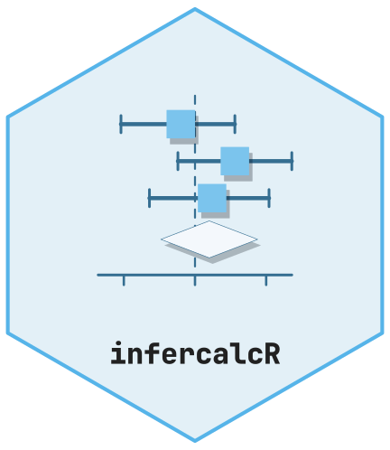

<!-- cttir-vignette-logo: start -->
<style>
.cttir-vignette-logo { float: right; width: 120px; max-width: 30%; margin: 0 0 1rem 1.5rem; }
.cttir-vignette-logo img { width: 100%; height: auto; border: 0; background: transparent; box-shadow: none; }
.cttir-vignette-logo .cttir-vignette-logo-light { display: block; }
.cttir-vignette-logo .cttir-vignette-logo-dark { display: none; }
@media (prefers-color-scheme: dark) {
  .cttir-vignette-logo .cttir-vignette-logo-light { display: none; }
  .cttir-vignette-logo .cttir-vignette-logo-dark { display: block; }
}
[data-bs-theme="light"] .cttir-vignette-logo .cttir-vignette-logo-light { display: block; }
[data-bs-theme="light"] .cttir-vignette-logo .cttir-vignette-logo-dark { display: none; }
[data-bs-theme="dark"] .cttir-vignette-logo .cttir-vignette-logo-light { display: none; }
[data-bs-theme="dark"] .cttir-vignette-logo .cttir-vignette-logo-dark { display: block; }
</style>
<div class="cttir-vignette-logo">
  
  
</div>
<!-- cttir-vignette-logo: end -->

```{r setup, include=FALSE}
knitr::opts_chunk$set(collapse = TRUE, comment = "#>")
library(infercalcR)
```

infercalcR carries out statistical procedures that the analyst names in
advance. It never chooses a test from the data, for example after a normality
pretest. Every procedure returns the same kind of object: a table of finalized
rows (estimates, intervals, p-values, counts and a status), a list of metadata
(method identity, settings, population and provenance) and a method-specific
payload.

This tutorial follows that workflow on a small synthetic data set: describe the
data, specify a method, compute it and read the result. It then converts results
produced by base R and adjusts a declared family of p-values. The code runs
offline and needs only the packages that ship with R.

## Synthetic data

The data imitate a two-arm study with three continuous outcomes and one binary
characteristic. Two blood-pressure values are missing on purpose.

```{r data}
set.seed(2026)
trial <- data.frame(
  id = 1:24,
  arm = factor(rep(c("control", "treatment"), each = 12)),
  sbp = round(c(rnorm(12, mean = 142, sd = 11), rnorm(12, mean = 132, sd = 11)), 1),
  dbp = round(c(rnorm(12, mean = 88, sd = 8), rnorm(12, mean = 84, sd = 8)), 1),
  heart_rate = round(c(rnorm(12, mean = 74, sd = 9), rnorm(12, mean = 73, sd = 9))),
  smoker = factor(sample(c("no", "yes"), 24, replace = TRUE, prob = c(0.7, 0.3)))
)
trial$sbp[c(5, 17)] <- NA
head(trial)
```

## Describe the data

`describe_data()` summarizes variables, optionally within groups. It computes
no hypothesis tests. Continuous variables get the mean, standard deviation,
median, quartiles and range; categorical variables get counts and proportions.

```{r describe}
desc <- describe_data(
  trial,
  variables = c("sbp", "smoker"),
  group = "arm",
  labels = c(sbp = "Systolic blood pressure", smoker = "Current smoker"),
  units = c(sbp = "mmHg")
)
class(desc)
desc_rows <- result_data(desc)
desc_rows[, c("group", "variable_id", "estimand", "level", "estimate",
              "proportion", "n", "n.missing", "n.total")]
```

Missing values are counted in `n.missing` and kept apart from the `n` used for
each summary. Category proportions use the non-missing observations within a
group as their denominator. The result has the same structure as an inferential
result, so the same accessors work on it.

## Choose a method explicitly

`method_catalogue()` lists the method identities that `run_inference()` accepts,
the package that provides the computation and the option names each method
understands.

```{r catalogue}
catalogue <- method_catalogue()
dim(catalogue)
table(catalogue$implemented)
catalogue[c("t_means_two_independent_welch", "rank_sum_mann_whitney",
            "regression_negative_binomial"), c("backend", "implemented")]
```

Most methods use only `stats` and `utils`. A few rely on an optional package,
such as MASS for negative binomial regression. Such a package is used only when
it is installed; if it is missing, the method stops with an explicit error and
no other model is fitted in its place. `?observed-methods` lists the arguments
that each method takes.

A specification fixes the method, the alternative hypothesis, the confidence
level, the missing-data policy and any method options before the data are seen.

```{r specification}
spec <- method_spec("t_means_two_independent_welch",
                    alternative = "two.sided", conf.level = 0.95)
str(unclass(spec))
```

Unknown options and impossible settings are rejected when the specification is
created, not silently ignored later.

```{r specification-errors}
tryCatch(
  method_spec("t_means_two_independent_welch", options = list(var.equal = TRUE)),
  error = conditionMessage
)
tryCatch(
  method_spec("t_means_two_independent_welch", conf.level = 1),
  error = conditionMessage
)
```

## Compute the result

The default missing-data policy is `"error"`. Because the blood-pressure values
contain missing entries, the Welch test refuses to run on them.

```{r missing-values}
treated <- trial$sbp[trial$arm == "treatment"]
control <- trial$sbp[trial$arm == "control"]
tryCatch(run_inference(spec, x = treated, y = control), error = conditionMessage)
```

`missing = "omit"` does not change this for the Welch test: the package does not
pick a missing-data assumption on the analyst's behalf. Here we decide to
analyze the complete observations and do so visibly in the code. A `result_id`
gives the result a stable name for later joins.

```{r compute}
x_complete <- treated[!is.na(treated)]
y_complete <- control[!is.na(control)]
welch <- run_inference(spec, x = x_complete, y = y_complete,
                       result_id = "sbp-welch")
welch
```

## Read the result contract

`result_data()` returns the finalized rows as a data frame. Every result has the
same mandatory columns; unavailable quantities are `NA`.

```{r rows}
rows <- result_data(welch)
rows[, c("estimand", "estimate", "conf.low", "conf.high", "conf.level",
         "interval.method")]
rows[, c("statistic", "df", "p.value", "p.adjusted", "p.reported",
         "alternative", "n", "n.excluded", "status", "reason")]
```

The `estimand` names the quantity, including its direction: here the mean of
`x` (treatment) minus the mean of `y` (control). The interval columns record
the level, the method and the scale. `p.value` is the raw p-value, `p.adjusted`
stays empty until a multiplicity adjustment is requested, and `p.reported` is
the value meant for display. Check `status` before using an estimate: besides
`"ok"`, a row can be `"undefined"`, `"not_applicable"`, `"unsupported"`,
`"invalid_input"`, `"numerical_failure"`, `"infeasible"`, `"reference_pending"`
or `"unresolved"`, with an explanation in `reason`.

`result_metadata()` records how the result came about.

```{r metadata}
meta <- result_metadata(welch)
meta[c("method_id", "variant_id", "result_id", "kind", "contract_version")]
str(meta$settings[c("alternative", "conf.level", "missing", "options")])
str(meta$population)
str(meta$provenance)
```

The payload keeps the complete output of the underlying computation, including
quantities that do not fit in a single row.

```{r payload}
str(welch$payload$native, give.attr = FALSE)
```

The numbers agree with a direct call to `stats::t.test()` on the same vectors.

```{r agreement}
reference <- stats::t.test(x_complete, y_complete)
stopifnot(
  isTRUE(all.equal(rows$p.value, reference$p.value)),
  isTRUE(all.equal(c(rows$conf.low, rows$conf.high),
                   as.numeric(reference$conf.int)))
)
```

## Prespecified alternatives use the same pattern

A different procedure is another specification, not a fallback chosen after
looking at the data. The Mann-Whitney rank-sum test, for example, reports a
probability of superiority as its descriptive estimate. The `exact` option is
declared in the specification.

```{r rank-sum}
rank_spec <- method_spec("rank_sum_mann_whitney", options = list(exact = FALSE))
rank_sum <- run_inference(rank_spec, x = x_complete, y = y_complete,
                          result_id = "sbp-rank-sum")
result_data(rank_sum)[, c("estimand", "estimate", "p.value", "n", "status")]
```

## Convert results computed elsewhere

`as_inference()` turns a supported `htest`, `lm` or `glm` object into the same
contract. It does not refit anything. Sample sizes are not recovered from
degrees of freedom, so they are supplied together with a description of the
analysis population.

```{r convert-htest}
imported <- as_inference(
  reference,
  n = c(length(x_complete), length(y_complete)),
  population = "Synthetic trial, complete observations",
  groups = c("treatment", "control")
)
result_data(imported)[, c("estimand", "estimate", "conf.low", "conf.high",
                          "p.value", "n")]
```

A fitted linear model is summarized once, with classical t intervals for each
coefficient.

```{r convert-lm}
model <- lm(sbp ~ arm, data = trial)
coefficients <- result_data(
  as_inference(model, population = "Synthetic trial, complete observations")
)
print(coefficients[, c("contrast", "estimate", "conf.low", "conf.high", "p.value")],
      row.names = FALSE)
```

`lm()` drops the two incomplete rows through its own `na.action`; the population
label states this explicitly.

## Adjust a declared family of p-values

Suppose the three continuous outcomes form a prespecified family of secondary
comparisons. Each is analyzed with the same specification, and the rows are
collected into one result with `new_inference_result()`.

```{r family}
secondary <- lapply(c("sbp", "dbp", "heart_rate"), function(variable) {
  values <- trial[[variable]]
  keep <- !is.na(values)
  fit <- run_inference(spec,
                       x = values[keep & trial$arm == "treatment"],
                       y = values[keep & trial$arm == "control"])
  out <- result_data(fit)[, c("estimand", "estimate", "conf.low", "conf.high",
                              "conf.level", "p.value", "alternative", "n")]
  out$row_id <- variable
  out
})
family <- new_inference_result(
  do.call(rbind, secondary),
  metadata = list(method_id = "t_means_two_independent_welch",
                  result_id = "secondary-outcomes")
)
class(validate_inference(family))
```

`adjust_inference()` adjusts the complete family once and records the family
identifier and size. The raw p-values and the confidence intervals stay
unchanged.

```{r adjust}
adjusted <- adjust_inference(family, method = "holm", family_id = "secondary")
result_data(adjusted)[, c("row_id", "estimate", "p.value", "p.adjusted",
                          "p.reported", "p.method", "family_id", "family_size")]
```

A second adjustment of the same rows is refused, so a reported p-value cannot
be adjusted twice by accident.

```{r adjust-twice}
tryCatch(adjust_inference(adjusted, family_id = "secondary-again"),
         error = conditionMessage)
```

## Keep a record

A result is an ordinary S3 list and can be saved as RDS. Load RDS files only
from trusted sources.

```{r save}
path <- tempfile(fileext = ".rds")
saveRDS(welch, path)
restored <- readRDS(path)
stopifnot(identical(result_data(restored), result_data(welch)))
unlink(path)
```

Archive the specification and the result together with the package version
(recorded in the provenance metadata), the repository revision and the output of
`sessionInfo()`.

## Continue

The [diagnostic accuracy tutorial](classification.html) covers classifier
metrics and cutoffs; the [exact tests tutorial](exact-tests.html) covers
Boschloo's test for two-by-two tables. `?result-contract` describes the result
columns in full.

```{r session-information}
sessionInfo()
```
